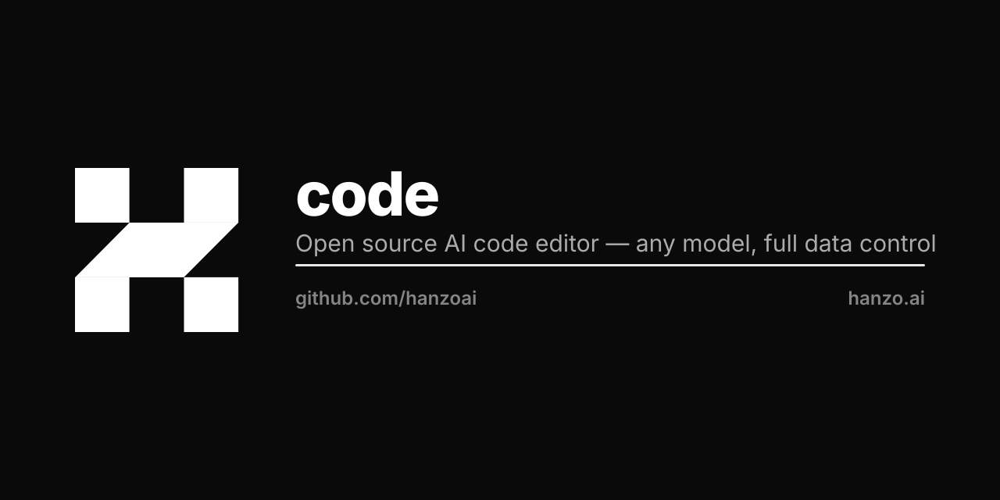

# code

  

Code is the open-source Cursor alternative.

This repo contains the full sourcecode for Code. We are currently in [open beta]() for Discord members (see the `announcements` channel), with a waitlist for our official release. If you're new, welcome!

- 👋 [Discord](https://discord.gg/)

- 🔨 [Contribute](https://github.com/hanzoai/code/blob/main/CONTRIBUTING.md)

- 🚙 [Roadmap](https://github.com/orgs/hanzoai/projects/2)

- 📝 [Changelog](https://code.hanzo.ai/changelog)

## Contributing

1. To get started working on Code, see [Contributing](https://github.com/hanzoai/code/blob/main/CONTRIBUTING.md).

2. We're open to collaborations and suggestions of all types - just reach out.

## Reference

Code is a fork of the [vscode](https://github.com/microsoft/vscode) repository. For some useful links on VSCode, see [`CODE_USEFUL_LINKS.md`](https://github.com/hanzoai/code/blob/main/CODE_USEFUL_LINKS.md).

## Support
Feel free to reach out in our Discord or contact us via email: hello@code.hanzo.ai.
